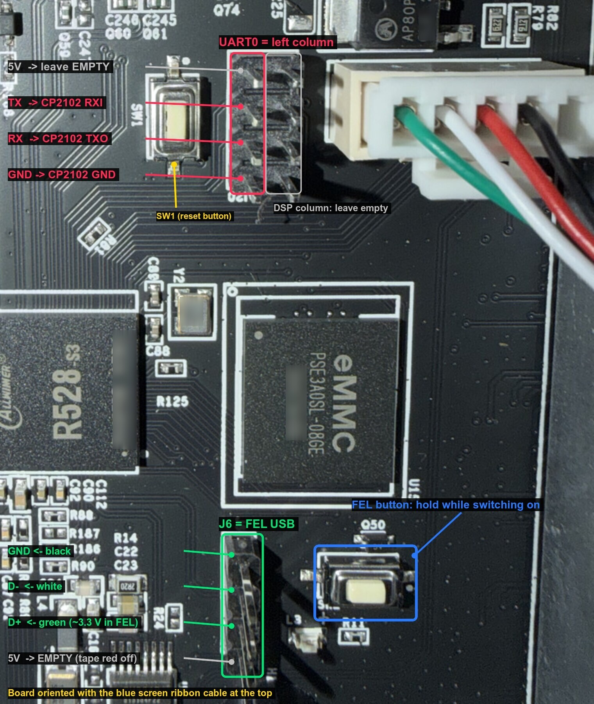

# Elegoo Centauri Carbon 2: bootloop recovery via UART + FEL

How a Centauri Carbon 2 stuck on its splash screen (kernel panic on a corrupt root filesystem after a custom firmware flash) was recovered without reflashing anything: a serial console to see the failure, the SoC's FEL mode to run a recovery U-Boot from RAM, and a 3-byte edit of the U-Boot environment to boot the untouched stock slot. Also: restoring the broken slot, key-only SSH without the web-upload exploit, a camera-process swap, and a memory logger.

> **Disclaimer.** Done on one printer (mainboard EF-M2 V1.0.150, stock firmware 02.01.00.00) in October 2026. Verify every offset, pin and partition on your own unit before writing anything. You can make things worse; you are responsible for your device. Not affiliated with Elegoo.

Repository layout: `scripts/` (UART console bridge, U-Boot helper, env backup/patch), `uboot/` (recovery U-Boot build), `ssh-via-uboot/` (installer `rc.local` + staging script), `printer/` (memory logger), `images/`.

## Summary

The CC2 was recovered without reflashing anything: three single-byte edits in the U-Boot environment pointed the bootloader back at the untouched stock slot B, and the printer booted normally on 8 Oct 2026.

- **What broke:** a custom 02.01.00.01 image (stock 02.01.00.00 with a replaced `/opt/bin/ai_camera`) was flashed over USB. The updater accepted it, wrote it to slot A (`bootA` + `rootfsA` = `mmcblk0p7`) and switched to it.
- **Root cause (proven by the UART log):** the repacked squashfs in `rootfsA` is corrupt. The kernel mounts it, then `SQUASHFS error: xz decompression failed` partway through the image, then `Kernel panic … Requested init /sbin/init failed (error -5)` at 2.65 s. The splash screen simply stays up. The image also lost its xattrs (`NO_XATTRS` flag set; stock has them), consistent with a repack done on macOS without root.
- **Why it looked hopeless:** Elegoo's U-Boot has its console muted and ignores keys; Linux dies before any shell; the USB offline update runs inside `elegoo_printer`, which never starts.
- **What worked:** UART console (CP2102) to watch the boot → FEL mode via the board's FEL button + a cut USB cable on header J6 → a self-built mainline U-Boot (OpenCentauri's CC2 board support, recovery config) loaded into RAM with `sunxi-fel` → edit `boot_partition`, `root_partition`, `systemAB_next` from `A` to `B` in both env copies with `mw.b`, fix the CRC, `mmc write`, verify, power-cycle.
- **Result:** boots `root=/dev/mmcblk0p8` (stock squashfs built 7 Jul 2026), init, Wi-Fi, DSP and MCUs all come up. Backups of the original env are in `env-backup/`.

## Inventory

Everything below was confirmed on this unit (mainboard silkscreen `EF-M2.V1.0.150`) unless marked otherwise.

### Printer

| Item | Value |
| --- | --- |
| SoC | Allwinner R528-S3, FEL ID `0x00185900` (`soc=00001859`) |
| RAM / storage | 128 MiB DDR3 @ 792 MHz / 8 GB eMMC (7474 MB, on SMHC2 = U-Boot `mmc 1`) |
| Stock firmware | 02.01.00.00, kernel 5.4.61 #745 (7 Jul 2026), U-Boot 2018.05 (Allwinner), OP-TEE |
| Kernel console | `ttyS2` = UART2 @ `0x02500800`, 115200 8N1, pins PE2/PE3 |
| Boot chain | BootROM → BOOT0 (prints `[62]HELLO! BOOT0`) → U-Boot (silent) → Linux |

### eMMC partition table (GPT, 512-byte LBAs)

| # | Name | Start LBA | End LBA | Notes |
| --- | --- | --- | --- | --- |
| 1 | boot-resourceA | `0xa1f8` | `0xa9f7` |  |
| 2 | boot-resourceB | `0xa9f8` | `0xb1f7` |  |
| 3 | env | `0xb1f8` | `0xb3ef` | byte offset `0x163F000`, env copy 1 |
| 4 | env-redund | `0xb3f0` | `0xb5e7` | byte offset `0x167E000`, env copy 2 |
| 5 | bootA | `0xb5e8` | `0xe71f` | Android boot image, `r528-evb1` |
| 6 | bootB | `0xe720` | `0x11857` | identical header to bootA |
| 7 | rootfsA | `0x11858` | `0x51857` | custom image, corrupt |
| 8 | rootfsB | `0x51858` | `0x91857` | stock squashfs, 123.5 MB of 128 MB |
| 9 | rootfs\_data | `0x91858` | `0x191857` | overlay (settings) |
| 10 | dsp0 | `0x191858` | `0x192037` | DSP firmware |
| 11 | private | `0x192038` | `0x192817` |  |
| 12 | UDISK | `0x192818` | `0xe993de` | print files (`/opt/usr`) |

### U-Boot environment format

Standard U-Boot **redundant** env, size `0x20000` (128 KiB) per copy: bytes 0–3 = CRC32 (little-endian) over bytes 5…`0x1ffff`; byte 4 = flags counter (the copy with the higher counter is current); then `key=value\0` pairs ending in `\0\0`, zero-padded. The slot variables before the fix:

```
boot_partition=bootA
root_partition=rootfsA
systemAB_next=A
bootcmd=run setargs_mmc boot_dsp0 boot_normal
boot_normal=sunxi_flash read 43000000 ${boot_partition};bootm 43000000
swu_next=reboot
parts_clean=rootfs_data
ota_flag=true
```

There is no `upgrade_available` / `bootcount`, so stock never rolls back on its own.

### Hardware used

| Item | Used for |
| --- | --- |
| CP2102 breakout (pins 3V3, DTR, RXI, TXO, GND, +5V), header soldered on | UART console, 3.3 V logic |
| USB-A to micro-USB data cable | CP2102 to Mac |
| USB-A to micro-USB data cable, micro end cut off | FEL connection to header J6 |
| Female-female jumper wires, tape | header connections |
| Multimeter (continuity + DC volts) | pin identification |

### Host and tools (macOS, Apple Silicon)

| Tool | Version / source |
| --- | --- |
| xfel | v1.4.0, built from [xboot/xfel](https://github.com/xboot/xfel) |
| sunxi-fel | built from [linux-sunxi/sunxi-tools](https://github.com/linux-sunxi/sunxi-tools) (needs Homebrew `dtc`, `libusb`) |
| U-Boot | v2026.01 from source.denx.de + [OpenCentauri/cosmos](https://github.com/OpenCentauri/cosmos) CC2 patches, built with Homebrew `arm-none-eabi-gcc` 16.2.0 |
| Python | 3.14, venv with `setuptools`, `pyelftools`, `pylibfdt` |
| Serial driver | built-in macOS `AppleUSBSLCOM`, device `/dev/cu.usbserial-0001` |

## What did not work, and why

Every dead end, in the order it was tried. Skip straight to the procedure below; this is here so nobody repeats them.

| # | Attempt | What happened | Why it failed |
| --- | --- | --- | --- |
| 1 | Assume an A/B auto-rollback after repeated power cycles | Not tried in the end; ruled out by research | Stock env has no `upgrade_available`/`bootcount`/`altbootcmd`; Allwinner's switch code only reads `systemAB_next`. OpenCentauri maintainer: Elegoo "has no way to switch between these for recovery". |
| 2 | USB offline update with the official `.zip.sig` | Not possible | The update is driven by `elegoo_printer` (`update_ota.cpp` runs `update_ipk.sh ota …`). That process never starts on a panicking rootfs. No boot-time USB recovery exists on CC2. |
| 4 | CP2102 not seen by the Mac | No `/dev/cu.usbserial*` | Bad/loose solder or charge-only cable; fixed by resoldering and using a data cable. A loopback test (RXI–TXO jumpered) then passed 5/5. |
| 5 | UART: spam `s`, space, Ctrl-C at power-on to stop Elegoo U-Boot | BOOT0 logs `key press : s`, then U-Boot prints nothing and boots on | Elegoo muted and locked U-Boot's console. Retried with Enter, Esc, `q`, `x`, `a` — same. On CC1 this only worked on old app 2.39. |
| 6 | FEL with D+/D− per the diagram (green on pin 2) | Mac saw nothing; screen black, UART silent | D+ and D− were swapped versus the cable. Found by measuring J6 in FEL mode: the D+ pin sits at about 3.3 V (device pull-up). Swapping green/white fixed it instantly. |
| 7 | CP2102 dropped off USB mid-session | Logger crashed (`FileNotFoundError`) | Micro-USB plug loose / unplugged. Reseat before every session. |
| 8 | OpenCentauri's `uboot239.bin` (Elegoo's **CC1** U-Boot) via `xfel ddr r528-s3`, `xfel write 0x43000000`, `xfel exec 0x43000b50` | No output; \~2 s later the chip reset and booted normally from eMMC (BOOT0 at uptime 117 s) | Built for CC1, not CC2. Wasted one cycle, wrote nothing. |
| 9 | COSMOS nightly CC2 U-Boot (`u-boot-sunxi-with-spl.bin` from `cosmos-centauri-carbon-2.swu`) via `sunxi-fel uboot` | SPL printed `DRAM: 128 MiB` / `Trying to boot from FEL`, then main U-Boot silent, blank screen | That build loads its env from the eMMC (`ENV_IS_IN_MMC` at `0x163F000`) — i.e. Elegoo's stock env — which silences the console and autoboots. |
| 10 | Same U-Boot started directly (`xfel ddr` + `xfel write 0x42E00000 u-boot.bin` + `xfel exec`) | Still silent | Same cause as #10. Typing `setenv stdout serial` blind also showed nothing. |
| 11 | Two scripts reading the serial port at once | Lost output, `BlockingIOError` crash | Only one process may own `/dev/cu.usbserial-0001`. Use a single console bridge. |
| 12 | Sending several U-Boot commands in one burst | Later commands silently dropped | The UART RX FIFO overflows while U-Boot is printing. Send one command, wait for `=>`, then the next. |
| 13 | Mass storage: `ums 0 mmc 1` to edit the eMMC from the Mac | U-Boot served it (`UMS: LUN 0 … count 0xe99400`), macOS asked to allow the accessory, but no disk ever appeared; console showed `musb-hdrc: peripheral reset irq lost!` | Most likely the missing VBUS (5 V wire intentionally left off) or a MUSB gadget quirk. Not needed: the env was edited from U-Boot directly. |
| 14 | Building U-Boot: `make defconfig frag.config` | Fragments silently ignored | U-Boot did not merge the fragments that way. Concatenate defconfig + fragments into one new defconfig instead. |
| 15 | Building U-Boot: in-tree `pylibfdt` with SWIG 4 + Python 3.14 | Compile errors (`PyInt_AsLong`, `PyString_FromString`) | Use `pip install pylibfdt` in a venv and build with `NO_PYTHON=1`. |
| 16 | Building U-Boot: final `binman` packaging | `AttributeError: module '_libfdt' has no attribute 'fdt_node_header_name_set'` | Irrelevant: `spl/sunxi-spl.bin` and `u-boot.bin` are already built; load them separately with `sunxi-fel spl` + `write` + `exe`. |
| 17 | Recovery config with `CONFIG_ENV_SOURCE_FILE` still set | Two `bootcmd=` entries compiled in; the board env file's would win | Add `CONFIG_ENV_SOURCE_FILE=""` so only `bootcmd=ums 0 mmc 1`, `bootdelay=0` remain. |
| 18 | U-Boot output via `stdout=serial,vidconsole` | A 8 KiB `md.b` dump took over 60 s | Rendering to the LCD is slow. `setenv stdout serial; setenv stderr serial` makes the same dump take 4 s. |

## Wiring

Two connections, both to headers that are already fitted on the mainboard: no soldering on the printer. Work with the printer unplugged from mains; the PSU area (yellow sticker) carries mains voltage.

**Access:** remove CANVAS, spool and loose parts, lay the printer on its side or back on a towel, unscrew the bottom cover. The mainboard runs along one edge of the underside. Orientation used below: blue screen ribbon cable at the **top**, USB-A port on the left, eMMC chip in the middle.

A photo of the underside with the cover off is on [OpenCentauri's CC2 hardware page](https://docs.opencentauri.cc/hardware/CC2/).




This unit's board (EF-M2.V1.0.150), oriented as in the tables below. Red = UART0 pins used by the CP2102; green = J6 with the cut-USB wire colours; blue = the FEL button. The white 4-wire plug at the right is the printer's own cable, not part of this setup.

### UART: 2×4 header next to button SW1

The header has two columns of four. The **left column** (next to SW1) is UART0 = Linux `ttyS2`; the right column is DSP, leave it empty.

| Left column, top to bottom | Signal | CP2102 pin |
| --- | --- | --- |
| 1 (towards Q60/Q61) | 5 V | nothing |
| 2 | TX (printer out) | **RXI** |
| 3 | RX (printer in) | **TXO** |
| 4 (by the small "0…" label) | GND | **GND** |

CP2102 3V3, DTR and +5V stay unconnected. Settings: 115200 8N1, no flow control.

### FEL USB: 4-pin header J6, below the eMMC chip

The FEL push-button sits right of J6. Cut the micro-USB end off a USB-A data cable; keep the USB-A plug for the Mac.

| J6, top (nearest eMMC) to bottom | Signal | Cable wire |
| --- | --- | --- |
| 1 | GND | black |
| 2 | D− (as found on this board) | **white** |
| 3 | D+ (reads \~3.3 V in FEL) | **green** |
| 4 | 5 V (reads \~5 V) | nothing; tape the red wire off on its own |

OpenCentauri's diagram shows D+ on pin 2. On this unit D+ was pin 3: always confirm with the voltage test below rather than trusting colours or diagrams.

### Verification before trusting the setup

1. **Cable data test:** plug the CP2102 in with the cable you plan to cut; if `/dev/cu.usbserial-*` appears, the cable carries data.
2. **Cable continuity:** multimeter in beep mode, probe from each USB-A contact to the matching jumper socket. Outer contacts = 5 V and GND (red finds 5 V); the middle contact next to 5 V is D− (white), next to GND is D+ (green). No beep between black, green and white.
3. **CP2102 loopback:** jumper RXI–TXO, run the loopback script (Scripts section). Expect `5/5 passed`.
4. **Ground:** printer off, J6 pin 1 and UART pin 4 must beep against the metal shell of the printer's USB-A port; J6 pin 4 must not.
5. **J6 voltages in FEL** (black probe on the USB-A shell): one data pin \~3.3 V = D+, which gets green; bottom pin \~5 V; others \~0 V.
6. **UART alive:** a normal power-on prints `HELLO! BOOT0 is starting!` and the kernel log; a key you send shows up as `key press : <key>` in BOOT0's output.

## Host setup (macOS)

About 15 minutes on an Apple Silicon Mac with Homebrew and Xcode command-line tools. `W` is any empty working directory.

### 1. Packages

```bash
brew install libusb pkgconf dtc swig make u-boot-tools arm-none-eabi-gcc openssl@3
```

### 2. FEL tools

```bash
cd $W
git clone --depth 1 https://github.com/xboot/xfel.git
(cd xfel && make -j8)
git clone --depth 1 https://github.com/linux-sunxi/sunxi-tools.git
cd sunxi-tools
make sunxi-fel CFLAGS="-I$(brew --prefix dtc)/include -O2" LDFLAGS="-L$(brew --prefix dtc)/lib"
```

Check: `xfel/xfel version` and `sunxi-tools/sunxi-fel version` print "No FEL device found" until the printer is in FEL; then `AWUSBFEX … R528`. macOS asks once to allow the USB accessory: click Allow (and again when the device changes identity, e.g. to a U-Boot gadget).

### 3. Recovery U-Boot for CC2

Shortcut: `uboot/build-recovery-uboot.sh [--ext4-write]` runs all of the steps below. The manual version follows.

Upstream U-Boot v2026.01 with OpenCentauri's CC2 board files and patches from [cosmos/meta-opencentauri/recipes-bsp/u-boot/files](https://github.com/OpenCentauri/cosmos/tree/main/meta-opencentauri/recipes-bsp/u-boot/files).

```bash
cd $W
git clone --depth 1 --branch v2026.01 https://source.denx.de/u-boot/u-boot.git
mkdir files && cd files
for f in $(gh api repos/OpenCentauri/cosmos/contents/meta-opencentauri/recipes-bsp/u-boot/files --jq '.[] | select(.type=="file") | .name'); do
  gh api repos/OpenCentauri/cosmos/contents/meta-opencentauri/recipes-bsp/u-boot/files/$f --jq .content | base64 -d > $f
done
cd ../u-boot
for p in ../files/0001-*.patch ../files/0002-*.patch; do git apply --whitespace=nowarn "$p"; done
cp ../files/elegoo-centauri-carbon*.dts dts/upstream/src/arm/
cp ../files/*_defconfig ../files/*.config configs/
cp ../files/*.env board/sunxi/

# One combined defconfig: CC2 board + USB-mass-storage recovery + no env from eMMC
cat configs/elegoo_centauri_carbon2_defconfig configs/usb-msd-cc2.config > configs/cc2_msd_defconfig
printf 'CONFIG_ENV_SOURCE_FILE=""\nCONFIG_BOOTDELAY=0\n' >> configs/cc2_msd_defconfig

python3 -m venv ../venv && ../venv/bin/pip install setuptools pyelftools pylibfdt
export CROSS_COMPILE=arm-none-eabi- PATH="$PWD/../venv/bin:$(brew --prefix make)/libexec/gnubin:$PATH"
O=$(brew --prefix openssl@3)
make O=../build-msd cc2_msd_defconfig
make O=../build-msd -j10 NO_PYTHON=1 HOSTCFLAGS="-I$O/include" HOSTLDFLAGS="-L$O/lib" || true
```

The final `binman` step fails on macOS (see dead end 16); ignore it. Confirm the two files you need exist and carry the right settings:

```bash
ls -l ../build-msd/spl/sunxi-spl.bin ../build-msd/u-boot.bin   # 24576 and ~577 KB
grep -E 'ENV_IS_NOWHERE|^CONFIG_BOOTCOMMAND|ENV_SOURCE_FILE' ../build-msd/.config
strings -n4 ../build-msd/u-boot.bin | grep -E '^bootcmd=|^bootdelay='
# expect: CONFIG_ENV_IS_NOWHERE=y, bootcmd=ums 0 mmc 1, bootdelay=0, and NO second bootcmd
```

Why this build and not the published ones: it never reads Elegoo's stored env (which silences the console), it has `mmc`, `crc32`, `mw`, `md`, `cmp` and `ums`, and its console is UART2 on PE2/PE3, the same pins as the header.

## Recovery procedure

The whole run takes about 10 minutes once tools and wiring exist. Nothing touches the eMMC until step 11. `S` = this repo's `scripts/` folder; `F` = the sunxi-tools folder; `B` = `build-msd`.

1. **Capture a normal boot first.** Start the console bridge in listen mode, power the printer on normally, and read the log:

   ```bash
   : > $S/uart_inbox.txt
   python3 -I $S/uart_console.py /dev/cu.usbserial-0001 $S/../cc2-boot.log $S/uart_inbox.txt '' 3600 &
   ```

   Look for `Kernel command line: … root=/dev/mmcblk0pN` and the error just before the panic. `p7` = slot A, `p8` = slot B. The broken slot is the one in that line; the target is the other one. Leave the bridge running for the rest of the procedure.
2. **Enter FEL.** Printer off. Hold the FEL button, switch on, keep holding 3 s, release. Screen stays black and the UART stays silent. Click Allow on the macOS accessory prompt.
3. **Confirm FEL.** `$F/sunxi-fel version` → `AWUSBFEX soc=00001859(R528)`. If nothing: re-check J6 (Wiring → verification steps 4–5).
4. **Load and start the recovery U-Boot into RAM** (nothing is written to flash):

   ```bash
   $F/sunxi-fel -v spl $B/spl/sunxi-spl.bin
   $F/sunxi-fel -p write 0x42e00000 $B/u-boot.bin
   $F/sunxi-fel exe 0x42e00000
   ```

   The console shows `U-Boot SPL 2026.01 … DRAM: 128 MiB`, the panel init lines, `UMS: LUN 0, dev mmc 1 …` and a spinner. The screen lights up.
5. **Get the prompt and make output fast:** send Ctrl-C to leave UMS, then switch output to serial only.

   ```bash
   printf '\x03\n' >> $S/uart_inbox.txt
   $S/ub.sh 'setenv stdout serial' 'setenv stderr serial' 'version'
   ```
6. **Check the partition map** matches the Inventory table: `$S/ub.sh 'mmc dev 1' 'mmc part'`. Stop if env is not at `0xb1f8` / `0xb3f0`.
7. **Load both env copies into RAM and verify their CRCs:**

   ```bash
   $S/ub.sh 'mmc read 0x40000000 0xb1f8 0x100' 'mmc read 0x40100000 0xb3f0 0x100' \
            'md.l 0x40000000 2' 'crc32 0x40000005 0x1fffb' \
            'md.l 0x40100000 2' 'crc32 0x40100005 0x1fffb'
   ```

   Each `crc32` result must equal the first word of its `md.l`. Byte 4 (low byte of the second word) is the flags counter.
8. **Back up the env to the Mac:**

   ```bash
   $S/ub.sh 'md.b 0x40000000 0x2000' > $S/envdump_raw.txt
   $S/ub.sh 'md.b 0x40100000 0x2000' > $S/envdump2_raw.txt
   python3 -I $S/env_backup.py $S/envdump_raw.txt $S/envdump2_raw.txt env-backup
   ```

   The script rebuilds each 128 KiB copy (the tail beyond 8 KiB is zero) and must print `MATCH` for both CRCs; that proves the backup is byte-exact.
9. **Check the target slot is healthy** (for slot B; use `0xb5e8` / `0x11858` for slot A):

   ```bash
   $S/ub.sh 'mmc read 0x41000000 0xe720 0x8' 'md.b 0x41000000 0x40' \
            'mmc read 0x41200000 0x51858 0x8' 'md.b 0x41200000 0x60'
   ```

   Boot partition must start `ANDROID!`; rootfs must start `hsqs`. Bytes 8–11 of the squashfs header are its build time (stock 02.01.00.00 = `f2 c1 4c 6a`, 7 Jul 2026); bytes 40–47 = bytes used, which must be smaller than the partition (128 MiB).
10. **Generate and stage the edit in RAM only:**

    ```bash
    python3 -I $S/env_patch.py env-backup $S/env_patch_cmds.txt   # A -> B
    $S/ub.sh 'md.b <addr> 0x40' 'md.b <addr> 0x40'   # optional: look at the bytes around the offsets the script printed
    IFS=$'\n'; $S/ub.sh $(cat $S/env_patch_cmds.txt)
    $S/ub.sh 'crc32 0x40000005 0x1fffb' 'md.l 0x40000000 2' 'crc32 0x40100005 0x1fffb' 'md.l 0x40100000 2'
    ```

    Offsets and CRCs differ per unit; the script computes them. The new `crc32` values must equal the stored first words and the flags bytes must be unchanged. The generated list has this shape (three one-byte edits per copy, `0x42` = `B`, then the new CRC):

    ```
    mw.b 0x400007xx 0x42      (three times, copy 1)
    mw.l 0x40000000 <new CRC of copy 1>
    mw.b 0x401007xx 0x42      (three times, copy 2)
    mw.l 0x40100000 <new CRC of copy 2>
    ```
11. **Write and verify:**

    ```bash
    $S/ub.sh 'mmc write 0x40000000 0xb1f8 0x100' 'mmc write 0x40100000 0xb3f0 0x100' \
             'mmc read 0x42000000 0xb1f8 0x100' 'mmc read 0x42100000 0xb3f0 0x100' \
             'cmp.b 0x40000000 0x42000000 0x20000' 'cmp.b 0x40100000 0x42100000 0x20000' \
             'crc32 0x42000005 0x1fffb' 'crc32 0x42100005 0x1fffb'
    ```

    Expect `256 blocks written: OK` twice and `Total of 131072 byte(s) were the same` twice.
12. **Reboot normally** (power off, power on, no FEL button) and check the log: `root=/dev/mmcblk0p8`, `VFS: Mounted root (squashfs filesystem)`, `init: Console is alive`, `procd: - init -`, Wi-Fi connecting, `remoteproc0 … dsp_rproc is now up`. Touchscreen reaches home; CANVAS LEDs stop flashing red.
13. **Clean up:** stop the bridge (`pkill -f uart_console.py`), unplug J6 and the UART jumpers, refit the bottom cover.

### Optional: restore the broken slot from the good one

Done on 8 Oct 2026 after the fix, in about 2 minutes: slot A now holds a byte-identical copy of stock slot B. The env stays on B. Repeat procedure steps 2–6, then:

1. **Compare the boot partitions.** On this unit they were already identical (same size and CRC), so nothing was written.

   ```bash
   UB_TIMEOUT=120 $S/ub.sh 'mmc read 0x40000000 0xe720 0x3138' 'mmc read 0x41000000 0xb5e8 0x3138' \
                           'cmp.b 0x40000000 0x41000000 0x627000'
   ```
2. **Copy rootfsB → rootfsA** in eight 16 MiB chunks (`0x8000` sectors), reading each back and comparing; the loop stops at the first mismatch.

   ```bash
   export UB_TIMEOUT=180; ok=0
   for i in 0 1 2 3 4 5 6 7; do
     off=$((i*0x8000)); src=$(printf '0x%x' $((0x51858+off))); dst=$(printf '0x%x' $((0x11858+off)))
     out=$($S/ub.sh "mmc read 0x40000000 $src 0x8000" "mmc write 0x40000000 $dst 0x8000" \
                    "mmc read 0x41000000 $dst 0x8000" "cmp.b 0x40000000 0x41000000 0x1000000")
     echo "$out" | grep -q 'Total of 16777216 byte(s) were the same' && ok=$((ok+1)) || { echo "chunk $i FAILED"; break; }
   done; echo "verified $ok/8"
   ```

   Expect `verified 8/8`. Swap the two base sectors to copy A → B instead.
3. **Check:** `mmc read 0x41300000 0x11858 0x8` + `md.b 0x41300000 0x30` must show `hsqs` and build time `f2 c1 4c 6a`. Re-read the env and confirm it still says `bootB` / `rootfsB` / `systemAB_next=B` with a valid CRC.

After the first good boot, stock Linux rewrites the env itself (here both flags counters went up by two, `ota_flag=false`, `parts_clean` removed). That is normal; always re-dump the env before any later edit instead of reusing an old backup.

## Scripts

All in `scripts/`, standard-library Python and POSIX shell only. `env_backup.py` + `env_patch.py` were re-run against the real dumps and reproduce the exact commands that fixed the printer.

| File | Role |
| --- | --- |
| `uart_console.py` | The single owner of the serial port: logs everything to a file, sends lines appended to `uart_inbox.txt`, optional key-spam until `=>`. Run: `python3 -I uart_console.py /dev/cu.usbserial-XXXX LOGFILE INBOX SPAM SECONDS` |
| `ub.sh` | Sends one U-Boot command at a time through the bridge and waits for the next `=>` (avoids the RX FIFO overflow, dead end 12). `CC2_LOG` overrides the log path |
| `loopback.py` | CP2102 self-test with RXI–TXO jumpered: expect `5/5 passed` |
| `env_backup.py` | Rebuilds both 128 KiB env copies from `md.b` dumps, verifies their CRCs, saves `.bin` + `.txt` |
| `env_patch.py` | Computes the one-byte edits and new CRCs that switch the A/B slot and writes the `mw` command list |

## Enabling SSH from U-Boot (no exploit, no network)

Done on 8 Oct 2026: key-based root SSH on stock 02.01.00.00, by writing Elegoo's own v01 OpenSSH files into the overlay from U-Boot. The stock slots are never touched.

**Why not the web route:** xlch88's method writes via `/upload/udisk` path traversal. On this unit every POST to the printer returned HTTP 501 while `GET /system/info?X-Token=…` worked. Neme77's patch notes explain: stock only runs the upload server after a mode change and only accepts uploads in machine states 1 and 11.

### Provenance of the binaries

| Check | Result |
| --- | --- |
| v01.03.02.51 `.zip.sig`, inner `.swu.sig`, `ota-package-list.json.sig` vs Elegoo RSA public key | PASS ×3 |
| MD5 of download vs MD5 in the official filename | `2ab3ffd72854dfd40af180c57fb9bb31` match |
| SWU parts vs Elegoo's own `cpio_item_md5` | 6/6 match |
| `sshd`, `sftp-server`, `init.d/sshd`, `sshd_config`, `keep.d/openssh-server` from xlch88 vs official v01 rootfs | all byte-identical (`sshd` SHA-256 `7746b708…`) |
| v02.01.00.00 package signature, and its rootfs header vs the printer's rootfsB | PASS, identical |
| Libraries `sshd` needs on v02 (`libcrypto.so.1.1`, `libz.so.1`, glibc set) | all present; only `sshd` was removed |

Decrypt/verify tool: `builder/current/tools/cc2_sig_tool_v1.1.py` and `keys/cc2_stock_public.pem` from Neme77's repo. The outer `.zip.sig` is signed only (type `0x04`): strip its 512-byte header to get the zip; the inner `.swu.sig` (type `0x80`) is AES-256-CBC, key published by the [OpenCentauri](https://github.com/OpenCentauri/cc-fw-tools) project.

### Why the files go flat into /upper/etc

`rootfs_data` (`mmcblk0p9`) is ext4 (no `metadata_csum`), mounted as OpenWrt's overlay. Its `/upper/etc` already exists; `/upper/usr` does not, and U-Boot's `ext4write` cannot create directories. So every file is written as a **new** file named `/upper/etc/cc2ssh-*`, plus a new `/upper/etc/rc.local` that installs them at boot (Linux can create folders and set modes). No existing file is modified.

### Steps

1. Build a recovery U-Boot with write support: same as Host setup step 3, plus `CONFIG_CMD_EXT4_WRITE=y` and `CONFIG_EXT4_WRITE=y` in the defconfig (`build-w`).
2. Stage the files with `ssh-via-uboot/make_stage.py ROOTFS_DIR ~/.ssh/id_ed25519.pub OUT_DIR`, where ROOTFS_DIR is the official v01.03.02.51 rootfs you extracted and verified yourself (the script checks each file's SHA-256). It copies sshd, sftp-server, the init script, sshd\_config and the keep list, adds your public key as `cc2ssh-authorized_keys`, generates three host key pairs, adds the installer `rc.local`, and writes `manifest.tsv` (a 1 MiB RAM slot from `0x40000000` per file, with size and CRC32). Keep OUT\_DIR private: it holds the host private keys.
3. FEL, then load SPL, the files and U-Boot:

   ```bash
   $F spl build-w/spl/sunxi-spl.bin
   while IFS=$'\t' read n addr size crc; do $F write $addr OUT_DIR/stage/$n; done < OUT_DIR/manifest.tsv
   $F write 0x42e00000 build-w/u-boot.bin && $F exe 0x42e00000
   ```
4. At the prompt (Ctrl-C out of UMS, `setenv stdout serial`): check each file with `crc32 <addr> <size>` against the manifest, and `bdinfo` shows U-Boot relocated far above them (`relocaddr 0x47e7a000`).
5. Write and verify each file:

   ```bash
   while IFS=$'\t' read n addr size crc; do ./ub.sh "ext4write mmc 1:9 $addr /upper/etc/$n $size"; done < OUT_DIR/manifest.tsv
   while IFS=$'\t' read n addr size crc; do ./ub.sh "ext4load mmc 1:9 0x41000000 /upper/etc/$n" "crc32 0x41000000 $size"; done < OUT_DIR/manifest.tsv
   ```

   Result here: 13/13 written and read back with matching CRCs; the 8 pre-existing files unchanged.
6. Reboot normally. The log shows `EXT4-fs (mmcblk0p9): mounted filesystem` and `mount_root: switched to extroot`. Then:

   ```bash
   ssh root@PRINTER_IP
   ```

   The host key offered must equal the one `make_stage.py` generated (`ssh-keygen -lf OUT_DIR/stage/cc2ssh-host_ed25519_key.pub`).

To remove SSH: delete `/etc/cc2ssh-*`, restore a stock `rc.local` (three lines: `/etc/init_dir.sh`, `/etc/time_sync.sh`, `exit 0`) and reboot, or wipe the overlay with `parts_clean=rootfs_data`.

### The installer rc.local

```sh
/etc/init_dir.sh

inst() { [ -f "$1" ] || return 0; mkdir -p "$(dirname "$2")"; cmp -s "$1" "$2" 2>/dev/null || cp "$1" "$2"; chmod "$3" "$2"; }
inst /etc/cc2ssh-sshd            /usr/sbin/sshd                       0755
inst /etc/cc2ssh-sftp-server     /usr/lib/sftp-server                 0755
inst /etc/cc2ssh-sshd.init       /etc/init.d/sshd                     0755
inst /etc/cc2ssh-sshd_config     /etc/ssh/sshd_config                 0644
inst /etc/cc2ssh-keep            /lib/upgrade/keep.d/openssh-server   0644
for t in rsa ecdsa ed25519; do
    inst /etc/cc2ssh-host_${t}_key     /etc/ssh/ssh_host_${t}_key     0600
    inst /etc/cc2ssh-host_${t}_key.pub /etc/ssh/ssh_host_${t}_key.pub 0644
done
if [ -f /etc/cc2ssh-authorized_keys ]; then
    home=$(awk -F: '$1=="root"{print $6}' /etc/passwd); [ -n "$home" ] || home=/root
    inst /etc/cc2ssh-authorized_keys "$home/.ssh/authorized_keys" 0600
    chmod 0700 "$home/.ssh"
fi
grep -q '^sshd:' /etc/group || echo 'sshd:x:22:sshd' >> /etc/group
mkdir -m 0700 -p /var/empty
if [ -x /etc/init.d/sshd ] && ! pidof sshd >/dev/null 2>&1; then
    /etc/init.d/sshd start
fi

/etc/time_sync.sh
exit 0
```

## Replacing ai\_camera over SSH

Done on 8 Oct 2026: stock `ai_camera` replaced with [viridivn/ai\_camera](https://github.com/viridivn/ai_camera) v0.2.3 as a one-file change in the overlay. (A faster, self-healing fork of it is at [dunca/elegoo-cc2-camera](https://github.com/dunca/elegoo-cc2-camera).) Idle memory dropped from 12.9 MB to 8.9 MB; stream unchanged on port 8080.

| Item | Value |
| --- | --- |
| Stock binary | `/opt/bin/ai_camera`, 4,160,772 bytes, MD5 `9763acd140cfb4916222b1c17e4eab37` (identical to the one in Elegoo's signed 02.01.00.00 rootfs) |
| Backups | `/opt/bin/ai_camera.stock` on the printer; a copy on your computer |
| Replacement | v0.2.3 release asset, 2,935,060 bytes, SHA-256 `9f9c6113…b665c5` = GitHub's recorded digest, MD5 `37b16ba3cfe26c2fc08f9b81c497030e`; static-pie ARM (musl), no library dependencies |
| How it starts | `/etc/init.d/printer` runs `ai_camera &` with no arguments (no procd supervision) |

### Steps

```bash
# on your computer: fetch and check
gh release download v0.2.3 --repo viridivn/ai_camera --pattern ai_camera
shasum -a 256 ai_camera   # must equal the digest shown on the release page

# back up stock (printer + Mac)
ssh root@PRINTER_IP 'cp -p /opt/bin/ai_camera /opt/bin/ai_camera.stock && md5sum /opt/bin/ai_camera*'
scp root@PRINTER_IP:/opt/bin/ai_camera ./ai_camera.stock-02.01.00.00

# test from RAM without replacing anything
cat ai_camera | ssh root@PRINTER_IP 'cat > /tmp/ai_camera.new && chmod 755 /tmp/ai_camera.new && killall ai_camera; cd /tmp && (/tmp/ai_camera.new > /tmp/aicam.log 2>&1 &)'
curl -s -m 5 -D - -o /dev/null http://PRINTER_IP:8080/    # expect 200, multipart/x-mixed-replace

# install and start
ssh root@PRINTER_IP 'killall ai_camera.new; cp /tmp/ai_camera.new /opt/bin/ai_camera && chmod 755 /opt/bin/ai_camera && sync && cd / && start-stop-daemon -S -b -x /opt/bin/ai_camera'
```

Test result: log `Negotiated format: MJPG (1280x720)`, 177 JPEG frames in a 6 s sample (about 30 fps), about 2 MB/s.

Pitfalls: the SSH shell's `PATH` lacks `/opt/bin` and the box has no `setsid`, so a bare `ai_camera &` from SSH dies with the session; use the full path with `start-stop-daemon -b`. The author tested only in LAN-only mode.

**Undo:** `cp /opt/bin/ai_camera.stock /opt/bin/ai_camera` and reboot.

## Memory logger

`printer/memlog.sh`: a BusyBox loop appends one CSV line per minute to `/opt/usr/memlog/memlog.csv` on the print-file partition (disk, not RAM; `/tmp` is RAM on this board). It costs about 1.5 MB resident and about 12 KB of log per hour. Started by `/etc/rc.local` on every boot (previous version kept as `/etc/rc.local.before-memlog`).

Columns: `epoch, uptime_s, mem_avail_kb, mem_free_kb, cached_kb, printer_rss_kb, camera_rss_kb, gui_rss_kb, camera_pid, load1, oom_events`. A changing `camera_pid` means the camera restarted; a rising `oom_events` means the kernel killed something (`dmesg | grep -i oom` says what).

Self-cleaning: once the log passes 2 MB (about a week) it is renamed `memlog.prev.csv`, replacing the older one, and a fresh file starts, so disk use stays under about 4 MB. Size-based rather than weekly because the printer clock is unreliable and there is no cron.

```sh
#!/bin/sh
# CC2 memory logger: one CSV line per minute to /opt/usr/memlog/memlog.csv (disk, not RAM).
# Self-cleaning: past 2 MB (~1 week) the log becomes memlog.prev.csv; disk use stays under ~4 MB.
D=/opt/usr/memlog; F=$D/memlog.csv; MAX=2097152; mkdir -p $D
HDR="epoch,uptime_s,mem_avail_kb,mem_free_kb,cached_kb,printer_rss_kb,camera_rss_kb,gui_rss_kb,camera_pid,load1,oom_events"
rss() { p=$(pidof "$1" | cut -d' ' -f1); if [ -n "$p" ]; then awk '/^VmRSS:/{print $2}' /proc/$p/status 2>/dev/null; else echo 0; fi; }
while :; do
  [ -f $F ] && [ $(wc -c < $F) -gt $MAX ] && mv -f $F $D/memlog.prev.csv
  [ -f $F ] || echo "$HDR" > $F
  set -- $(awk '/^MemAvailable:/{a=$2} /^MemFree:/{f=$2} /^Cached:/{c=$2} END{print a, f, c}' /proc/meminfo)
  echo "$(date +%s),$(cut -d. -f1 /proc/uptime),$1,$2,$3,$(rss elegoo_printer),$(rss ai_camera),$(rss ec-eeb001-gui),$(pidof ai_camera | cut -d' ' -f1),$(cut -d' ' -f1 /proc/loadavg),$(dmesg | grep -c -i -E 'out of memory|oom-kill')" >> $F
  sleep 60
done
```

Boot hook added to `/etc/rc.local`, just before `/etc/time_sync.sh`:

```sh
[ -f /opt/usr/memlog/memlog.sh ] && start-stop-daemon -S -b -m -p /var/run/memlog.pid -x /bin/sh -- /opt/usr/memlog/memlog.sh
```

Fetch the log: `scp root@PRINTER_IP:/opt/usr/memlog/memlog.csv .` Stop it: `start-stop-daemon -K -p /var/run/memlog.pid`.


## Rollback, aftermath and lessons

### Undo the env change

Repeat procedure steps 2–8, saving the fresh backup to a new folder (e.g. `env-now`), then run `env_patch.py env-now cmds.txt A` and steps 10–12. The script refuses if the env is already on the requested slot. The untouched originals are `env-copy1-p3-env.bin` and `env-copy2-p4-env-redund.bin` in your `env-backup/` folder.

### State after the fix

- Slot A was restored from slot B (see the optional step above), so both slots now hold stock 02.01.00.00. The next official Elegoo OTA writes the inactive slot (A) and switches to it.
- Left untouched in the env: `swu_next=reboot`, `parts_clean=rootfs_data`, `ota_flag=true` (leftovers of the failed update). Stock U-Boot cleans `rootfs_data` on boot, so Wi-Fi and settings may reset once; print files on `UDISK` are unaffected.

### Lessons

- **Never repack the rootfs on macOS.** This image failed xz decompression and lost its xattrs. Neme77's working builder runs squashfs-tools 4.6.1 on Linux with `mksquashfs … -comp xz -b 262144 -noappend -no-tailends -exports -all-root`. Better: keep stock firmware and swap single files over SSH.
- **Back up the env before any custom flash** (it is 2 × 128 KiB; a copy of the current slot vars is all a recovery needs).
- **The UART is the first tool, not the last.** Ten minutes with a CP2102 turned "bricked" into a specific squashfs error and a known-good slot.
- **Trust measurements over diagrams and wire colours.** D+ was found by its \~3.3 V pull-up in FEL mode.
- **One owner per serial port, one U-Boot command at a time**, and switch `stdout` to serial before dumping memory.
- **A muted vendor U-Boot is not the end.** FEL + a U-Boot that does not load the vendor env gives full eMMC access without opening anything else.

### Sources

- [OpenCentauri CC2 mainboard pinout](https://docs.opencentauri.cc/hardware/CC2/mainboard/) · [FEL mode (CC1)](https://docs.opencentauri.cc/software/FEL-mode/) · [CC2 updates](https://docs.opencentauri.cc/software/updates-cc2/)
- [OpenCentauri/cosmos](https://github.com/OpenCentauri/cosmos) (CC2 U-Boot board files, patches, `usb-msd-cc2.config`)
- [cc-fw-tools#51](https://github.com/OpenCentauri/cc-fw-tools/issues/51) (CC1 recovery by switching the boot partition in U-Boot) · [OpenCentauri#35](https://github.com/OpenCentauri/OpenCentauri/issues/35)
- [oc-u-boot sunxi\_switch\_system.c](https://github.com/OpenCentauri/oc-u-boot/blob/main/board/sunxi/sunxi_switch_system.c) (how `systemAB_next` is read)
- [elegooofficial/CentauriCarbon2](https://github.com/elegooofficial/CentauriCarbon2) `elegoo/update_ota.cpp` (why USB update needs the app)
- [Neme77/centauri-carbon-2-community](https://github.com/Neme77/centauri-carbon-2-community) `builder/current/core/firmware_builder.py` (known-good repack flags)
- [xboot/xfel](https://github.com/xboot/xfel) · [linux-sunxi/sunxi-tools](https://github.com/linux-sunxi/sunxi-tools)
